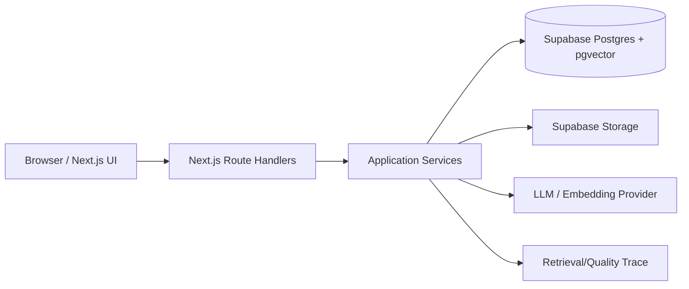

# Novera AI — Enterprise Knowledge Intelligence System（MVP）技术架构设计

> 产品定位：Novera AI 是企业知识智能系统，而非普通知识库 Chat。目标是将企业文档转化为可检索、可分析、可验证、可持续沉淀的知识资产。2–3 周内交付作品级 MVP；重点是 RAG、Task Understanding Layer、Evidence Layer 和可解释质量评分，不做多租户、权限、支付或复杂自主规划。

## 1. 推荐总体架构

采用“单 Next.js 应用 + Supabase 托管能力 + LLM/Embedding 适配器”的轻量分层架构：



- 前端：Next.js App Router、React、TypeScript、Tailwind（可配 shadcn/ui）。
- API/业务层：Next.js Route Handlers；所有 RAG 编排集中在 server-side application services，避免 UI 直接调用模型。
- 数据：Supabase Postgres + pgvector；Supabase Storage 保存原始文件。
- AI：通过 `LLMProvider`、`EmbeddingProvider` 接口隔离供应商；默认接入一个支持结构化输出的模型。
- 异步：MVP 不引入 Redis/Temporal。用 `documents.status`/`ingestion_jobs` 状态机，上传后由处理 API 触发；后续可无缝替换为队列 worker。

## 2. 组件边界

### Presentation

- `KnowledgeBasePage`：上传、文件列表、状态、删除。
- `ChatPage`：会话、问题输入、回答、来源与证据展开、评分卡、反馈。
- `EvidencePanel`：只展示后端返回的原文片段、文档标题、页码/段落和相似度，不在浏览器自行拼接证据。

### Application services

- `DocumentService`：文件元数据、签名上传 URL、删除/重建索引。
- `IngestionOrchestrator`：Parser → Normalizer → Chunker → Embedder → VectorRepository；每一步可重试且幂等。
- `TaskUnderstandingService`（对外称 Task Understanding Layer）：将问题归类为 `qa | summary | analysis | compare | recommend`，失败时回退 `qa`。
- `Retriever`：查询向量化、pgvector top-k 检索、阈值过滤、去重/来源多样性。
- `AnswerGenerator`：按任务类型选择 prompt；要求严格 JSON 输出（答案、claims、citations、limitations）。
- `EvidenceVerifier`：校验 citation ID 是否来自检索结果，按 claim 计算支持/部分支持/无支持；证据不足时触发保守回答。
- `QualityEvaluator`：计算 Retrieval Score、Evidence Coverage、Knowledge Match，并产出解释。
- `FeedbackService`：记录点赞/点踩及可选原因，为第二阶段 Memory Loop 提供数据。
- `KnowledgeInsightService`：仅做轻量事件沉淀，记录高频问题、无答案问题、低可信回答和知识缺口；MVP 不自动学习、不自动改写文档。

### Infrastructure adapters

- `StorageAdapter`（Supabase Storage）；`ParserAdapter`（PDF/Markdown/TXT，DOCX 可选）。
- `EmbeddingAdapter`、`LLMAdapter`；`VectorRepository`、`DocumentRepository`、`ConversationRepository`。
- `PromptRegistry`：版本化各任务 prompt，持久化 `prompt_version` 便于作品展示和回溯。

### Trust/安全边界

- 文档内容一律作为不可信数据放入明确 delimiters；系统提示要求忽略文档中的指令，防止 prompt injection。
- 只有 `READY` 文档的 chunk 才可检索；每条生成 claim 必须引用稳定的 chunk ID。
- “模型判断支持”仅作为辅助信号，最终 Evidence Coverage 由可审计的 citation 映射计算。

## 3. 端到端数据流

### A. 文档上传与索引

1. 浏览器 `POST /api/v1/documents/init`，提交文件名、MIME、大小、SHA-256 和可选标题；服务端校验请求，创建 `UPLOADING` 文档记录并返回短时 signed upload token。
2. 浏览器直传 Storage，避免 Next.js 服务器承载二进制。
3. 上传完成后调用 `POST /api/v1/documents/:id/complete`；服务端验证对象存在、文件大小和 MIME，并将状态原子更新为 `UPLOADED`。后续 ingestion endpoint 再将其推进至 `PROCESSING`。
4. Parser 提取文本并保留页码/段落/标题；Normalizer 清理页眉页脚、重复空白和乱码，同时保留原文偏移。
5. Chunker 按标题优先、约 500–800 token、80–120 token overlap 切片；每个 chunk 保留 `page_from/page_to`, `section`, `char_start/end`。
6. Embedding 按批次生成向量并写入 `document_chunks.embedding`；写入前按 `content_hash` 幂等去重。
7. 全部 chunk 成功后文档置为 `READY`；异常置为 `FAILED`，保留 `error_code/error_message`，支持重新处理。旧版本 chunk 在事务中失效/删除，避免脏检索。

### B. 问答、证据与评分

```mermaid
sequenceDiagram
  participant B as Browser
  participant A as Chat API
  participant C as Task Understanding Layer
  participant R as Retriever
  participant L as LLM
  participant E as Evidence/Quality
  participant D as DB
  B->>A: question + conversationId
  A->>C: classify(question)
  C-->>A: taskType + confidence
  A->>R: embed + vector search(topK, threshold)
  R->>D: pgvector query (READY chunks)
  D-->>R: chunks + similarity + source metadata
  A->>L: task prompt + numbered evidence chunks
  L-->>A: structured answer/claims/citations
  A->>E: verify claims ↔ chunk IDs; calculate scores
  E-->>A: answer + sources + evidence + metrics
  A->>D: persist messages/retrieval/evaluation/citations
  A-->>B: final structured response
```

具体规则：

- `top_k` 默认 6–8，先做 cosine similarity；MVP 暂不做 hybrid BM25、cross-encoder rerank。
- Prompt 将 chunk 编号为 `[S1]...`，要求每个 claim 返回 `citation_ids`；无足够证据时返回 `insufficient_evidence=true`。
- Evidence Layer 仅从已检索 chunk 取原文，返回 quote、document_id、title、page/section、similarity。
- Retrieval Score：由 top-k 相似度、阈值命中率和来源多样性归一化为 0–100。
- Evidence Coverage：有至少一个支持证据的 claim 数 / claim 总数 × 100；无 claim 时为 0。
- Knowledge Match：综合检索质量、证据覆盖、模型结构化置信度；建议公式 `0.4*retrieval + 0.4*coverage + 0.2*answer_confidence`，并在 UI 标注“启发式评分”。
- 低于阈值（如 Retrieval < 55 或 Coverage < 50）时，回答必须明确知识库不足，不能补写常识。

### C. 用户反馈

回答完成后 `POST /api/messages/:id/feedback`，只记录 `rating`、原因和时间；第一阶段不自动改写知识库。后台可按问题、文档、评分查询知识缺口，为第二阶段提供输入。

### D. Knowledge Insight Log

Knowledge Insight Log 是一个轻量、可审计的事件沉淀层，不是自动学习系统。每条记录必须关联原始问题或问答 run，并保存触发原因与阈值版本。

MVP 仅记录以下事件：

- `FREQUENT_QUESTION`：对规范化后的问题指纹累加计数，用于统计高频问题。
- `UNANSWERED_QUESTION`：回答状态为 `INSUFFICIENT_EVIDENCE`，或没有有效检索结果。
- `LOW_CONFIDENCE_ANSWER`：可信度低于当前版本阈值。
- `KNOWLEDGE_GAP`：无答案、低可信或用户反馈显示当前知识不足，可附带建议补充的主题。

写入规则：

1. 记录行为不得改变或延迟主回答；写入失败只记录服务端日志。
2. 不存储无必要的原始文档内容；优先保存 `qa_run_id`、问题指纹、事件类型和可解释元数据。
3. 只做数据沉淀和后续查询，不自动修改 chunk、prompt、评分阈值或知识文档。
4. 高频问题由聚合查询识别；不为每次重复提问创建凑数用的独立事件。

## 4. 关键非功能取舍（作品级 MVP）

| 维度 | MVP 选择 | 有意延后 |
|---|---|---|
| 部署 | Vercel + Supabase，一体化演示 | 独立 worker/Kubernetes |
| 任务执行 | API 触发 + 状态轮询，最多 1–2 次重试 | Redis/队列、长任务编排 |
| 检索 | pgvector cosine top-k + 元数据过滤 | 混合检索、reranker、知识图谱 |
| 模型调用 | 分类 1 次 + 生成 1 次；可选 verifier 关闭 | 多 Agent planning/工具循环 |
| 响应 | 先返回结构化最终 JSON；稳定后再加 SSE | 复杂流式状态同步 |
| 数据隔离 | 单默认 knowledge base；schema 留 `knowledge_base_id` | 多租户、RBAC、审计权限 |
| 规模边界 | 单文件约 20 MB/200 页，单库数千 chunks | 海量文档、跨库联邦 |
| 可靠性 | 状态机、幂等键、失败可重试、无证据拒答 | 端到端 exactly-once |
| 可观测性 | DB 中保存 retrieval/evaluation trace + 服务日志 | 完整 tracing/成本平台 |
| 成本 | 批量 embedding、限制上下文和 token；verifier 按需 | 实时质量模型、离线评测集 |

建议验收性能目标（用于 demo 自测，而非商业 SLA）：上传初始化 <1 s；10 MB/100 页文档索引 <60 s；常规问答 p95 <15 s；回答始终带来源/证据或明确“证据不足”。

## 5. MVP 明确不做

企业权限、多租户、支付、复杂后台、OCR/扫描件、自动知识重写、长期记忆循环、复杂自主规划、跨外部系统连接。所有接口用 adapter/状态机预留替换点即可。
