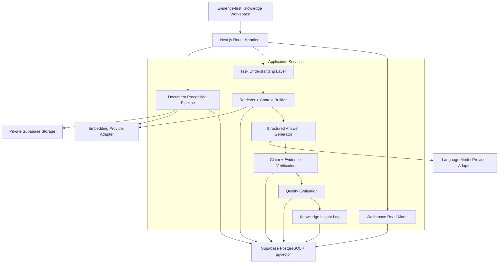

# Novera AI — Portfolio Case Study

**Product:** Enterprise Knowledge Intelligence System
**Project type:** AI Product Manager portfolio MVP
**Delivery horizon:** Three-week phased MVP
**Core stack:** Next.js 16, React 19, TypeScript, Supabase PostgreSQL, pgvector,
Supabase Storage, OpenAI-compatible provider adapters

The current structured-answer configuration defaults to `gpt-5-mini` and remains
environment-configurable; embedding defaults to `text-embedding-3-small` with
1536 dimensions.

## 1. Project snapshot

Novera AI turns enterprise documents into a knowledge system that can be
searched, analyzed, verified, and continuously observed.

The product is deliberately not positioned as another knowledge-base Chat
demo. Its central experience is:

```text
Enterprise question
→ Task Understanding
→ relevant knowledge retrieval
→ structured answer
→ claim-level verification
→ exact Evidence
→ Source Document + locator
→ explained quality scores
→ Knowledge Insight observation
```

The portfolio value is the combination of product design and AI-system design:

- RAG is treated as an auditable retrieval system, not a hidden prompt step;
- Agent capability starts with lightweight task understanding rather than an
  unnecessarily autonomous planner;
- Evidence is a persisted relationship, not decorative citation text;
- confidence is decomposed into explainable metrics; and
- usage signals are captured without pretending that the system automatically
  learns or repairs knowledge.

## 2. The problem

Enterprise knowledge often exists as static, fragmented files:

- product requirements in Markdown or PDF;
- user feedback in reports;
- operating procedures in text documents;
- product changes in release notes; and
- analysis spread across meeting notes and internal documents.

The problem is not only finding a paragraph. Teams need to answer questions
such as:

> Why is churn increasing, what evidence supports that conclusion, and what
> does the current knowledge base still not know?

Generic RAG chat interfaces leave four product gaps.

### 2.1 Answers are hard to audit

A source badge does not prove which statement it supports. Users need to trace
individual Claims to exact source text and original locations.

### 2.2 Retrieval quality is hidden

Users cannot tell whether the model had strong, diverse evidence or generated a
confident answer from weak context.

### 2.3 Different knowledge tasks are treated the same

Question answering, summarization, analysis, comparison, and recommendation
have different output expectations, but a standard chat box often routes all
of them through one generic prompt.

### 2.4 Knowledge gaps disappear after the answer

Unanswered questions and low-confidence runs are valuable signals. Most demos
discard them instead of creating a reviewable knowledge-improvement backlog.

## 3. Product thesis

The product thesis is:

> Enterprise knowledge becomes more valuable when every answer is both useful
> and inspectable.

That leads to four product principles:

1. **Knowledge state before chat history.** Show documents, processing state,
   indexed knowledge, recent QA Runs, and health signals.
2. **Claims before citations.** Break the answer into reviewable assertions and
   attach Evidence to each Claim.
3. **Explain confidence.** Show retrieval quality, evidence coverage, knowledge
   match, and final confidence with explanations.
4. **Observe before automating.** Capture knowledge gaps and repeated questions,
   but do not automatically rewrite source knowledge in the MVP.

## 4. Target users and jobs to be done

The first-version users are:

- product managers;
- startup teams;
- AI product teams; and
- small businesses with growing internal documentation.

Their core jobs are:

- understand a product or operational issue quickly;
- summarize multiple internal sources;
- compare product decisions or competitors;
- generate evidence-backed recommendations;
- verify where an AI conclusion came from; and
- discover where the knowledge base is incomplete.

## 5. Product experience

The main screen is a Knowledge Workspace, not a conversational transcript.

It brings together:

- Knowledge Health;
- document and processing status;
- READY-document and indexed-chunk counts;
- the Task Understanding Layer;
- the latest evidence-backed answer;
- Claim support states;
- Evidence Explorer;
- Source Documents;
- explained quality metrics;
- recent QA Runs; and
- Knowledge Insight signals.

The interface also distinguishes three connection states:

| State | Product behavior |
|---|---|
| Live | Supabase-backed documents, QA traces, Evidence, and Insights are connected |
| Demo | Portfolio-safe demonstration data is shown while connecting or by design |
| Disconnected | The UI clearly labels a demo fallback, or preserves the last live snapshot as stale |

This avoids presenting synthetic portfolio data as a real connected workspace.

## 6. System architecture



### Why this architecture

- A single Next.js application keeps a portfolio MVP deployable and easy to
  explain.
- Supabase provides private file storage, relational audit data, and vector
  retrieval without adding a separate vector service.
- Provider adapters isolate the product from one embedding or language-model
  vendor.
- Application services keep retrieval, generation, verification, and scoring
  out of the UI layer.
- Database state machines make ingestion and QA progress observable.

## 7. Knowledge processing design

The ingestion pipeline is:

```text
Document
→ Parser
→ Normalizer
→ structured Chunker
→ Embedding
→ pgvector storage
→ READY knowledge
```

Implemented parsers cover PDF, Markdown, UTF-8 TXT, and DOCX. The DOCX parser has
unit coverage; an end-to-end DOCX upload has not been verified in this review.

Each Chunk preserves the information required for later Evidence traceability:

- source document ID;
- chunk index and text hash;
- section hierarchy;
- source block relationships;
- original source text segments;
- page, line, and character locators; and
- embedding provider, model, version, dimension, and timestamp.

Chunk/vector publication and the READY transition are transactional. Partially
persisted knowledge cannot become retrievable.

## 8. Retrieval and Task Understanding

The first Agent capability is intentionally lightweight.

The Task Understanding Layer classifies a query as:

```text
qa | summary | analysis | compare | recommend
```

It uses deterministic bilingual rules, confidence, and an explicit task-type
override. This is enough to demonstrate intent-aware AI product behavior without
introducing a complex autonomous Agent loop.

The Retriever:

- embeds the normalized query;
- searches READY chunks only;
- applies knowledge-base and optional document filters;
- returns similarity, metadata, and source locator fields;
- supports configurable Top-K and threshold controls; and
- records embedding provenance without exposing the query vector.

The Context Builder does not send all results to the model. It applies:

- similarity filtering;
- deterministic ranking;
- duplicate removal;
- per-document limits;
- source-diversity controls;
- a maximum of eight prompt chunks by default; and
- token and character budgets.

Selected chunks receive stable labels such as `[S1]` for generation and
verification.

## 9. Evidence Layer innovation

The core product innovation is that Evidence is modeled as a first-class trust
layer.

```text
Answer
  → Claim
    → Evidence Item
      → Retrieval Result
        → Chunk
          → READY Source Document
            → original locator
```

### 9.1 Structured generation

The model must return strict JSON containing:

- `answer`;
- `claims`;
- `limitations`; and
- `insufficient_evidence`.

Each Claim includes its type, weight, and proposed citation/quote pairs. Free
text outside the schema is rejected.

### 9.2 Independent verification

Model citations are treated as proposals, not proof. Every Evidence item is
independently checked against:

1. the citation labels available in the bounded context;
2. the current QA Run's Retriever results;
3. the persisted Chunk identity;
4. the READY status of the Source Document;
5. an exact quote in the prompt context; and
6. the same exact quote in current database source text.

Evidence that fails any check is discarded with an auditable reason.

### 9.3 Claim support states

Claims are marked:

- `full` — verified Evidence and no rejected proposal;
- `partial` — verified Evidence plus at least one rejected proposal;
- `unsupported` — no proposal passed verification; or
- `conflict` — reserved for later contradiction detection.

If no Evidence survives, the unverified generated prose is replaced with a
deterministic insufficient-evidence answer. Unsupported Claims remain in the
audit trace, but the product does not label the answer as verified.

### 9.4 Persistence as a second trust boundary

The completion transaction revalidates the READY source and exact quote before
storing the QA Run, retrieval snapshots, Claims, Evidence, and quality metrics.
This prevents a UI-only citation convention from becoming the system's source
of truth.

## 10. Explainable quality evaluation

Each QA Run returns four 0–100 metrics with explanations and component details.

| Metric | What it represents |
|---|---|
| Retrieval Score | Similarity, threshold margin, and source diversity of selected context |
| Evidence Coverage | Weighted proportion of Claims supported by verified Evidence |
| Knowledge Match | Retrieval and Evidence strength after insufficiency/unsupported penalties |
| Confidence Score | Conservative composite with invalid-Evidence and unsupported-Claim penalties |

An insufficient-evidence answer is capped below 50 confidence. The UI exposes
the explanations instead of presenting a single unexplained percentage.

These metrics are transparent MVP heuristics, not statistically calibrated
probabilities.

## 11. Knowledge Insight Log

Novera records four lightweight signals:

- frequent questions;
- unanswered questions;
- low-confidence answers; and
- knowledge gaps.

Repeated normalized questions are aggregated using a stable fingerprint and
occurrence count. Insight logging is best-effort and cannot invalidate a
successful answer.

The important product boundary is explicit: this is observation, not automatic
learning. No document, Chunk, prompt, embedding, or model behavior is modified
without review.

## 12. Demo walkthrough

The recommended portfolio demonstration takes approximately six to eight minutes
using the checked-in fictional Asteria Workcloud corpus.

### Step 1 — Establish the product category

Open the Knowledge Workspace and introduce the positioning:

> Novera AI is an Enterprise Knowledge Intelligence System. The goal is not
> only to answer a question, but to make every answer traceable.

Point out the visible live/demo/disconnected indicator so the audience knows
whether the data is connected or illustrative.

### Step 2 — Show knowledge state

Use the summary and document areas to show:

- Knowledge Health;
- READY versus processing documents;
- indexed Chunk count; and
- recent QA Run history.

This establishes that the product manages knowledge state, not just messages.

### Step 3 — Explain ingestion

In a configured live environment, upload a PDF, Markdown, TXT, or DOCX file. Explain:

```text
signed private upload
→ processing status
→ parsing and normalization
→ structured chunks
→ embeddings
→ READY knowledge
```

The UI refreshes immediately and uses bounded polling while a document remains
uploading, uploaded, or processing.

### Step 4 — Run an analysis task

Use the primary manifest question:

```text
Analyze why early retention declined and separate strong evidence from directional signals.
```

Show that the Task Understanding Layer labels it as Analysis and the QA
endpoint returns a newly persisted structured Run.

In disconnected demo mode, this answer is illustrative. Live QA requires the
configured Supabase and model providers.

### Step 5 — Inspect answer sufficiency

Show:

- the AI Answer;
- confidence ring;
- known limitations;
- Verified / Review needed / Insufficient evidence state; and
- ordered Claims.

Emphasize that unsupported or insufficient output is never labelled verified.

### Step 6 — Trace a Claim

Select a Claim. The Evidence Explorer shows:

```text
Claim
→ citation label
→ exact quote
→ support score
→ Source Document
→ section/page/line locator
```

This is the main product moment: the user can inspect the reasoning substrate
instead of trusting a source badge.

### Step 7 — Explain quality and knowledge evolution

Review the four quality metrics, then scroll to Knowledge Insights.

Explain that repeated questions, gaps, and low-confidence answers are stored for
future review, while the MVP intentionally avoids automatic source mutation.

## 13. Results and validation

### Functional result

The repository implements the complete local application path:

```text
upload
→ process
→ chunk
→ embed
→ retrieve
→ understand task
→ generate structured answer
→ verify Claims and Evidence
→ evaluate quality
→ persist QA trace
→ render the Knowledge Workspace
```

### Automated verification

Verified locally on October 17, 2026:

- **165 passing tests across 37 files** (`npm test`);
- Demo integrity validation passed (`npm run demo:validate`); and
- deterministic retrieval evaluation passed (`npm run eval:retrieval`).

TypeScript, ESLint, and production build were not rerun for this review.

The build includes the Workspace, document, processing-job, retrieval, and QA
Route Handlers.

### Retrieval evaluation

The versioned five-case deterministic retrieval fixture produces:

- Hit Rate@K: `1.0`;
- Recall@K: `1.0`;
- Mean Reciprocal Rank: `1.0`;
- Document Recall@K: `1.0`; and
- Chunk Recall@K: `1.0`.

These numbers describe the checked-in expected-result fixture and evaluator
behavior. They are not measured live retrieval performance, and do not establish
staging or production quality.

### Portfolio demo dataset

`npm run demo:validate` passes for the checked-in Asteria Workcloud corpus:

```text
DEMO_DATASET_VALID dataset=novera-phase6-asteria-demo-v1 documents=5 supported_questions=14 knowledge_gap_cases=4 evidence_quotes=36
```

The corpus contains five fictional Markdown documents and covers QA, summary,
analysis, compare, recommend, and an intentional insufficient-evidence ARR
question. The manifest preserves exact expected Evidence and source locators;
`demo/demo-runbook.md` defines the repeatable presentation flow.

Browser rendering and responsive layouts were not verified as part of this
local validation pass.

## 14. Staging status

The repository includes:

```bash
npm run smoke:retrieval:staging
npm run smoke:qa:staging
npm run smoke:phase5:staging
npm run smoke:phase6:staging
```

The Phase 6 smoke uses the production upload APIs and a browser-equivalent anon
Supabase client with a short-lived signed token. It then verifies processing to
READY, Chunk/Embedding provenance, retrieval, QA, Claims, exact Evidence,
Sources, all four metrics, persistence, and cleanup.

No successful live staging result is currently claimed.

The current environment is missing:

- `QA_SMOKE_URL`;
- `NEXT_PUBLIC_SUPABASE_URL`;
- `NEXT_PUBLIC_SUPABASE_ANON_KEY`;
- `SUPABASE_SERVICE_ROLE_KEY`; and
- `OPENAI_API_KEY`.

The safe result is `PHASE6_STAGING_SMOKE_SKIPPED`. A portfolio demo can use the
clearly labelled local dataset, but live provider/database verification remains
a release gate.

## 15. Key product and technical trade-offs

| Decision | Benefit | Accepted limitation |
|---|---|---|
| Single Next.js application | Fast, coherent MVP delivery | No separate durable worker service |
| Supabase + pgvector | One auditable relational/vector foundation | Fixed 1536-dimension vector schema |
| Rule-based Task Understanding | Deterministic and easy to explain | No complex planning or tool loop |
| Exact-quote Evidence verification | Strong traceability and clear failure reasons | No semantic entailment or contradiction model |
| Heuristic quality metrics | Transparent and portfolio-friendly | Not calibrated probabilities |
| Observation-only Insight Log | Captures value without unsafe auto-learning | No automatic knowledge repair |
| Demo fallback | Product remains reviewable without secrets | Illustrative data is not a live-system proof |

## 16. Known limitations

- Live Supabase migrations were not executed locally because Docker/PostgreSQL
  is unavailable in the workspace environment.
- A successful real Supabase/OpenAI Phase 6 end-to-end staging smoke has not
  been recorded because the required staging configuration is absent.
- Background document processing uses lightweight Next.js execution and bounded
  client polling rather than a durable queue, lease, or watchdog.
- PDF parsing handles embedded text but not OCR, complex layout repair, or
  scanned documents.
- DOCX parsing is implemented and covered by parser unit tests; an end-to-end
  DOCX upload has not been verified here.
- Retrieval is vector-only; hybrid lexical retrieval and reranking are deferred.
- Evidence verification checks exact identity and quotations, not semantic
  entailment, contradiction, or source freshness beyond READY status.
- The source locator is visible, but there is no embedded document reader or
  direct PDF page deep link.
- Knowledge Health and answer metrics require calibration against real user and
  answer-quality datasets.
- The workspace uses fixed portfolio-scale query limits and a single default
  knowledge base.
- Authentication, permissions, multi-tenancy, streaming, Multi Agent planning,
  standalone analytics, and automatic knowledge optimization are out of scope.

## 17. What this case study demonstrates

Novera AI demonstrates more than the ability to connect a model to documents.
It shows:

- a clear enterprise AI product position;
- phased MVP scope control;
- retrieval and ingestion architecture understanding;
- Agent capability sized to the user problem;
- claim-level trustworthy AI design;
- explainable quality evaluation;
- failure and insufficient-evidence experience design;
- measurable knowledge-gap observation; and
- the ability to turn backend AI mechanics into an understandable product
  experience.

The strongest portfolio takeaway is the Evidence Layer: Novera treats trust as
a data model, verification workflow, and interaction design problem—not as a
citation icon added after generation.
