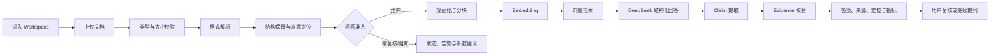

# Novera AI 个人作品集项目资料包

> 用途：个人作品集首页项目卡片，以及“查看完整项目介绍与案例”页面。
>
> 资料口径：以当前工作区、`main` 分支 HEAD `d5c41304a5e223ecd1d67f598d0e0bc1c2e144e1`、项目文档和真实运行记录为准。状态标记含义：`VERIFIED` = 有直接证据；`PARTIALLY VERIFIED` = 只有部分链路或部分环境得到验证；`UNVERIFIED` = 当前没有足够证据；`PLANNED` = 规划方向。
>
> 公开表达原则：可以突出产品判断、可靠性设计、真实评测和可追溯证据；不能把固定合成语料的结果写成真实客户效果，也不能把本地进程内 RAG 结果写成线上生产链路已验收。

## 1. 项目基础信息

### 1.1 项目概览

| 字段 | 内容 | 状态 |
| --- | --- | --- |
| 项目名称 | Novera AI | VERIFIED |
| 一句话定位 | 面向企业知识工作的证据优先文档问答系统：把多格式资料转成可检索、可引用、可复核的答案。 | VERIFIED（产品定位） |
| 所属领域 | 企业知识管理、文档智能、检索增强生成（RAG） | VERIFIED |
| 产品类型 | AI 知识工作台 / Enterprise Knowledge Intelligence System | VERIFIED |
| 目标用户 | 需要从经营资料、会议纪要、业务规范和分析文件中快速查找事实的企业知识工作者 | PARTIALLY VERIFIED（场景分析与产品设计，未做真实用户研究） |
| 核心场景 | 上传文档，解析并建立知识索引，提出事实、比较、分析或知识缺口问题，查看答案与 Evidence 来源链 | VERIFIED（代码与本地验证） |
| 关键问题 | 传统文档问答可能只给出答案，却无法说明答案来自哪份文件、哪一页、哪一行，也无法稳定处理扫描件、表格和不完整证据。 | VERIFIED（产品问题定义） |
| 核心价值 | 让答案与 Claim、Evidence、Source Document 和位置定位关联，并在证据不足时给出可解释的边界答复。 | VERIFIED |
| 当前形态 | Next.js Web 产品，包含 Workspace、文档处理、AI 助手、Evidence Explorer 和公开 Demo 模式。 | VERIFIED |
| 当前交付状态 | 当前本地工作区快照已部署到 Vercel Production；固定合成语料的真实 RAG 运行证据、独立 v3 离线复评报告和 GitHub 源码入口可查看。线上完整上传到问答链路未在本轮重新验收。 | PARTIALLY VERIFIED |
| 我的角色 | AI 产品经理 / 产品负责人：负责问题定义、范围与优先级、可靠性标准、RAG 评测设计、迭代判断、验收与交付整理；实现由本人协作使用 AI 编程工具完成，具体代码贡献按证据边界表述。 | VERIFIED（项目材料支持的工作维度） |
| 在线体验 | [https://novera-ai-gules.vercel.app/](https://novera-ai-gules.vercel.app/) | VERIFIED：当前 alias 指向 Production READY 部署 `dpl_GHxMJbP9Z7kuavCugjPUQ4rZgDxi`；本轮 HTTP 200。完整业务链路未重新验收 |
| GitHub 源码 | [https://github.com/jdu6380-svj/novera-ai](https://github.com/jdu6380-svj/novera-ai) | VERIFIED：公开仓库入口；GitHub `main` 为 `d5c41304a5e223ecd1d67f598d0e0bc1c2e144e1`。当前线上部署来自本地工作区快照，未推送的本地改动尚未同步到 GitHub |
| 完整案例入口 | `查看完整项目介绍与案例` | 文案建议见下文 |

### 1.2 我的实际工作边界

以下表述适合在作品集中使用：

- **问题分析与产品定位：VERIFIED。** 将问题从“模型能不能回答”重新定义为“答案是否有来源、位置和证据，证据不足时是否能安全处理”。
- **用户场景与需求拆解：VERIFIED。** 围绕企业经营资料、质量记录、会议纪要、规则文档和跨文档比较拆解 MVP 场景；没有把未经访谈的推测写成用户调研结论。
- **产品策略与优先级：VERIFIED。** 先建立解析边界、问答准入和 Evidence 规则，再扩展 XLSX、PPTX、OCR，避免不可靠内容直接进入 RAG。
- **AI 工作流与评估方案：VERIFIED。** 设计文档解析、分块、Embedding、检索、生成、Claim/Evidence 校验和逐题验收映射；固定 20 份文档与 40 个问题不被运行结果反向改写。
- **功能规划、实现协作与验收：VERIFIED。** 参与 Workspace、状态、上传、检索、回答、Evidence 展示和多格式解析的实现协作与回归验收。
- **测试设计、结果分析与迭代决策：VERIFIED。** 保留 v1 基线，建立 v2/v3 独立标准，区分真实运行、离线复评和线上部署验证。
- **代码署名边界：PARTIALLY VERIFIED。** 代码仓库与变更记录支持本人承担产品设计、实现协作和验收；不应写成全部代码均由本人逐行手工完成。
- **真实用户研究、满意度、采用率和商业结果：UNVERIFIED。** 本项目没有做真实用户测试，也没有可公开的业务指标。

## 2. 首页项目介绍文案

### 2.1 首页精简版

**Novera AI｜让企业知识问答有据可答**

Novera AI 是一个面向企业知识工作的证据优先文档问答系统。用户上传 PDF、Word、Markdown、TXT、Excel、PPT 和图片后，系统按格式提取结构与来源位置，完成检索增强生成，并把答案、Claims、Evidence 和原始来源连成可复核链路。我的工作重点是把“能回答”推进为“有证据地回答，证据不足时知道何时停下”。

**已验证亮点**：固定 20 份合成文档完成真实解析与准入；40 个问题完成真实 Query Embedding、向量检索和 DeepSeek 生成；基于真实运行记录的 v3 离线复评为 20/20 文档、40/40 问题通过，0 条无效引用、0 条无依据声明。该结果适用于固定验收集和 v3 标准，不等同于任意企业文档的泛化准确率。

**我的角色**：AI 产品经理，负责问题定义、可靠性策略、验收标准、RAG 评测、迭代判断和交付整理，并协作完成产品实现。

**查看完整项目介绍与案例 →**

### 2.2 首页完整介绍版

**产品定位**

Novera AI 把企业文档变成可检索、可引用、可复核的知识工作台。它不是只返回一段生成文本，而是同时展示任务理解、回答、Claim、Evidence、来源文档、位置定位和质量指标。

**使用场景**

当用户面对经营指标、质量记录、会议决定、规范条款或跨文件比较时，可以上传已有资料并直接提问。系统保留页码、行号、工作表行、表格行或幻灯片位置，帮助用户快速回到原文。

**核心工作流**

`上传文档 → 格式解析与告警 → 文本规范化与分块 → Embedding → 证据准入 → 向量检索 → 结构化回答 → Claim/Evidence 校验 → 来源定位与质量展示`

**核心能力**

1. 多格式解析：PDF、DOCX、Markdown、TXT、XLSX、PPTX 和 PNG 均有代码与固定语料运行记录。
2. 结构化来源：DOCX 表格、XLSX 工作表行和 PPTX 幻灯片文本保留结构化定位。
3. 证据优先回答：答案中的 Claim 必须能回到检索 chunk、源文档和可用定位。
4. 真实 RAG 评测：DashScope `text-embedding-v2` + 本地 `LocalVectorIndex` + DeepSeek `deepseek-flash`。
5. 知识缺口与复核边界：资料没有提供的值明确说明未披露；低置信 OCR 或未验证图表内容不直接成为答案证据。
6. Evidence-first Workspace：用户可以从回答进入 Claim、Evidence 和 Source Explorer。

**我的工作**

我负责把可靠性风险转成产品标准和可执行验收：定义文档 profile、问题标准、证据模式与来源定位，优先处理“错误内容进入问答”这一高风险问题；随后协作实现多格式解析、OCR 证据、问答准入、检索和 Evidence 展示，并用固定 20/40 语料做真实运行与复评。

**项目状态**

GitHub 源码可查看；本地固定语料的真实 RAG 运行记录和 v3 复评报告可复核。当前工作区快照已部署到 Production 在线入口；线上完整上传、处理、检索、问答链路仍未在本轮重新验收。部署内容包含尚未提交到 GitHub 的本地改动，因此线上版本与 GitHub `main` 当前并非同一源码快照。

### 2.3 首页项目卡片字段

- **产品定位**：面向企业知识工作的证据优先文档问答系统，把多格式资料转成可检索、可引用、可复核的答案。
- **使用场景**：从经营资料、质量记录、会议纪要和规则文档中查找事实、比较指标、定位出处或确认知识缺口。
- **核心工作流**：上传 → 解析 → 分块 → Embedding → 检索 → 生成 → Evidence 校验 → 来源定位。
- **我的工作**：问题定义、产品策略、可靠性标准、RAG 评测、迭代判断、实现协作和交付验收。
- **项目亮点**：格式感知解析；Evidence-first 回答；低置信内容的准入边界；固定语料上的可复核真实评测。
- **验证与成果**：真实运行覆盖 20 份文档和 40 个问题；v3 离线复评 20/20、40/40；0 invalid citation、0 unsupported claim；模型调用仅发生在本地进程内索引路径。
- **项目状态**：Production 在线入口已指向当前本地工作区部署并返回 HTTP 200；GitHub 仓库可公开查看，但当前本地改动尚未推送，线上版本与 GitHub `main` 不完全同步；线上真实业务链路不纳入已确认结果。

## 3. 九章完整案例

### 01 — Problem｜问题定义

#### 本章希望证明的产品能力

能够从企业知识工作的实际风险出发定义问题，而不是从“接入一个模型”开始堆功能。

#### 可直接用于网站的正文初稿

企业资料通常以 PDF、Word、表格、幻灯片和扫描图片分散保存。用户真正要找的是一个事实、一个变化、一个决定或一个出处，但传统文档问答容易把“回答出来”当成终点：用户仍然不知道数字来自哪一页、表格哪一行，或这项信息是否根本没有出现在资料中。

Novera AI 的问题定义是：**如何让企业文档问答同时满足答案可用、来源可追溯和证据边界可解释。**

本项目没有进行真实用户访谈，因此需求依据来自企业知识场景分析、产品原型、固定合成语料和解析/RAG 风险建模，而不是声称已被真实客户统计验证。

#### 适合展示的材料

- “答案 → Claim → Evidence → Source”信任链流程图。
- Workspace、AI Assistant、Evidence Explorer 截图。
- v1 解析边界与 v3 证据验收的对照表。

#### 事实证据

- `README.md`：Enterprise Knowledge Intelligence System 定位与 Phase 4/5 工作流。
- `docs/portfolio/novera-document-reliability-iteration.md`：解析不完整却被当成成功的风险定义。
- `docs/document-reliability-v3-closeout-2026-10-24.md`：固定语料与证据边界。

#### 结论状态

- 问题定义和产品机会：`VERIFIED`。
- 真实用户痛点规模、满意度和采用意愿：`UNVERIFIED`。

### 02 — Insight｜核心洞察

#### 本章希望证明的产品能力

能把模糊的“AI 准确率”拆成用户真正关心的可验证结果。

#### 可直接用于网站的正文初稿

这次迭代形成了三个核心洞察：

1. 文档问答的质量不只取决于答案文字是否像对的，还取决于答案是否来自正确文档、正确位置和可接受的证据。
2. 多格式文档不是同一种文本输入。Word 表格需要行列关系，Excel 需要工作表和物理行，PPT 需要幻灯片位置，扫描图像需要 OCR 来源和置信边界。
3. “资料没有提供”也是一种有价值的结果。对知识缺口问题，明确回答未披露并附上来源，比猜造一个数字更符合企业决策场景。

因此，产品机会不是做一个更会聊天的界面，而是建立一条可审计的知识链：输入被解析成带定位的块，只有通过准入的块进入检索，回答中的 Claim 再回到检索结果和原文完成验证。

#### 适合展示的材料

- 质量维度拆解图：解析状态、检索命中、回答、Evidence、定位、准入。
- `case-008/018/024/026` 的知识缺口回答示例。
- DOCX/XLSX/PPTX/PNG 的定位字段对照。

#### 事实证据

- `evals/document-reliability/acceptance.v3.json` 的 principles、standards 和逐 case 映射。
- `src/features/qa/application/evidence-verifier.ts`。
- `src/features/retrieval/application/retriever-service.ts`。

#### 结论状态

- 产品洞察和规则转化：`VERIFIED`。
- 洞察对真实用户行为的普遍性：`UNVERIFIED`。

### 03 — Key Decisions｜关键产品决策

#### 本章希望证明的产品能力

能在覆盖范围、可信度、实现成本和可验证性之间做出明确取舍。

#### 可直接用于网站的正文初稿

**决策一：先建立证据边界，再扩展格式。** 早期解析迭代先解决扫描页“看起来成功但实际上缺页”的问题，再扩展 XLSX、PPTX 和图片 OCR。原因是错误内容进入检索后的风险高于暂时不支持某种格式。

**决策二：把多格式解析定义成不同的来源契约。** DOCX 表格要求表头与值保持关联；XLSX 要求工作表、表头和物理行；PPTX 用例只采信独立幻灯片文本，不把未经验证的图表缓存当作证据；OCR 数字需要来源页和复核信息。

**决策三：让低置信内容进入“复核/拒答”路径。** v2 先对低置信 OCR 安全拒答，v3 在打印数字有解析置信度、裁切复核和来源定位时允许进入证据链。手写内容与通用图表视觉理解仍保持能力边界。

**决策四：用独立版本化标准验收。** v1 基线原样保留，v2/v3 单独建立映射与评分规则，不通过修改 Ground Truth 或把历史结果拼接来制造成绩。

**决策五：本轮真实 RAG 使用本地进程内索引。** 真实调用 DashScope 和 DeepSeek，但向量只进入 `LocalVectorIndex`，避免把验收数据写入 Production Supabase；线上 Supabase 链路另列为部署验证门槛。

#### 适合展示的材料

- v1 → v2 → v3 验收标准演进图。
- “可回答 / 需要复核 / 不进入检索”状态机。
- 多格式来源契约表。

#### 事实证据

- `evals/document-reliability/acceptance.v2.json`
- `evals/document-reliability/acceptance.v3.json`
- `docs/document-reliability-v2-final-2026-10-24.md`
- `docs/document-reliability-v3-closeout-2026-10-24.md`

#### 结论状态

- 关键产品取舍：`VERIFIED`。
- 真实生产成本、规模化性能和客户 ROI：`UNVERIFIED`。

### 04 — Product Experience｜产品体验

#### 本章希望证明的产品能力

把复杂的解析、检索和证据机制转译成用户能理解的 Workspace 体验。

#### 可直接用于网站的正文初稿

用户进入 Novera AI 后，首先看到 Knowledge Workspace：知识健康度、文档状态、最近 QA runs 和主要任务入口集中在同一工作区。用户可以添加知识文件，等待处理状态更新，然后在 Task Understanding 查询框中提出事实、比较、分析或建议类问题。

回答区域不只显示一段文本，还显示验证状态、可信评分、Claims、Evidence 数量和来源。用户选择一个 Claim 后，可以在 Evidence Explorer 中查看引用片段、文档名称、页码/行号/表格行/幻灯片等定位信息。没有足够证据时，界面保留“Insufficient evidence”或限制说明，不把不确定内容包装成确定答案。

公开 Demo 模式则使用预置的 Asteria Workcloud fictional corpus，展示跨文档分析和知识缺口拒答两个可重复场景；它与真实上传和线上业务链路分开标识。

#### 适合展示的材料

- `output/playwright/phase75-dashboard.png`
- `output/playwright/phase75-assistant.png`
- `output/playwright/phase75-evidence.png`
- `output/playwright/phase8-preview-home.png`
- `output/playwright/phase8-preview-assistant.png`
- `output/playwright/phase8-preview-evidence.png`

#### 事实证据

- `src/components/phase75/phase75-workspace.tsx`
- `src/components/phase5/phase5-shell.tsx`
- `src/components/phase75/public-demo-workspace.tsx`
- `docs/public-production-demo.md`

#### 结论状态

- 本地页面结构和交互：`VERIFIED`。
- 当前在线入口是否处于同一版本、是否允许完整上传问答：`PARTIALLY VERIFIED`。

### 05 — AI Workflow｜AI 工作流设计

#### 本章希望证明的产品能力

能够把模型、规则、解析、检索和证据验证组织成可解释的产品流程。

#### 可直接用于网站的正文初稿

Novera AI 的关键设计是把生成模型放在证据链之后，而不是让模型独立决定答案。完整流程如下：

```text
用户上传文件
  → 文件类型与大小校验
  → 格式解析（PDF / DOCX / Markdown / TXT / XLSX / PPTX / PNG）
  → 结构保留与来源定位（页、行、表格行、工作表、幻灯片）
  → 解析告警与问答准入
  → 文本规范化与分块
  → DashScope text-embedding-v2（1536 维）
  → LocalVectorIndex 余弦检索
  → DeepSeek deepseek-flash 结构化回答
  → Claim 提取
  → Evidence verifier 校验检索成员关系、原文引用、文档身份和定位
  → Workspace 展示答案、可信度、Evidence、来源与限制
```

输入和处理的职责分工：

- **解析器/规则**：识别格式、保留结构、生成 locator、产生 extraction warnings。
- **Embedding**：把允许进入问答的分块和用户问题转成向量。
- **Retriever**：在本轮本地索引中按相似度检索，不读取 Ground Truth 来引导答案。
- **DeepSeek**：基于受限上下文生成结构化答案、Claims、Evidence 引用和 limitations。
- **Evidence verifier**：检查引用是否属于当前检索结果、是否对应 READY/允许状态文档、原文是否一致、定位是否可解析。
- **产品状态**：对资料缺口、低置信 OCR、图表缓存或解析失败采取明确答复、复核或阻断。

这套工作流把“回答失败”与“正确拒答”区分开：知识缺口问题可以成功返回“资料未提供”；低置信或未验证内容不能被模型猜测为事实。

#### 适合展示的材料

- 端到端信任链 Mermaid 图。
- 真实运行 JSON 中一条 case 的 `retrieval`、`generation`、`evidence` 三段截面（脱敏后）。
- Evidence Explorer 截图。

#### 事实证据

- `src/features/knowledge-processing/content/parser.ts`
- `src/features/retrieval/application/retriever-service.ts`
- `src/features/qa/application/answer-generator.ts`
- `src/features/qa/application/evidence-verifier.ts`
- `evals/document-reliability/runs/2026-10-23T20-00-46-567Z-full-v3.json`

#### 结论状态

- 本地真实模型、检索和 Evidence 协作：`VERIFIED`。
- 线上 Production 完整链路：`UNVERIFIED`。
- 手写识别和通用图表视觉理解：`PLANNED / 能力边界`。

### 06 — Product Implementation｜产品实现

#### 本章希望证明的产品能力

能把产品判断落实成可运行的功能、状态和验收记录。

#### 可直接用于网站的正文初稿

本轮实现围绕用户任务组织，而不是只堆技术组件：

| 用户任务 | 产品实现 | 证据状态 |
| --- | --- | --- |
| 添加知识 | 文件选择、校验、签名上传初始化与完成接口；Workspace 反馈上传/处理状态 | `VERIFIED`（本地代码与回归） |
| 识别不同文件 | PDF、DOCX、Markdown、TXT、XLSX、PPTX、PNG parser | `VERIFIED`（固定语料运行） |
| 保留文档结构 | DOCX 表格行、XLSX 工作表行、PPTX 幻灯片文本、PDF/PNG 页级 locator | `VERIFIED`（适用用例） |
| 处理不确定内容 | extraction warnings、review_required、问答准入与限制说明 | `VERIFIED`（代码与固定验收）；线上 UI 版本需再核对 |
| 生成回答 | OpenAI-compatible provider adapter；本轮真实运行使用 DeepSeek `deepseek-flash` | `VERIFIED`（本地运行） |
| 语义检索 | DashScope `text-embedding-v2` + `LocalVectorIndex` | `VERIFIED`（本地运行） |
| 解释答案 | Claims、Evidence、Source、Confidence、metrics 和 Evidence Explorer | `VERIFIED`（本地页面/代码） |
| 公开演示 | Asteria Workcloud 预置场景，显式标注 Demo 数据 | `VERIFIED`（源码行为；部署激活状态需核对） |

当前实现不等于任意输入都能无损理解：DOCX 复杂合并/嵌入对象、PPTX 图表视觉内容和手写字符仍有审慎边界。产品将其转成告警、限制或人工复核路径，而不是静默当作成功。

#### 适合展示的材料

- 功能—任务—证据矩阵。
- parser、retriever、answer generator、Evidence verifier 代码导航。
- Workspace 状态和 Evidence Explorer 截图。

#### 事实证据

- `src/features/knowledge-processing/content/ooxml-parser.ts`
- `src/features/knowledge-processing/content/image-ocr.ts`
- `src/features/knowledge-processing/content/extraction-warnings.ts`
- `src/features/knowledge-processing/content/chunker.ts`
- `src/components/phase75/phase75-workspace.tsx`
- `README.md` 的 Implemented scope。

#### 结论状态

- 已列功能的代码存在与固定数据运行：`VERIFIED`。
- 线上环境变量、Production Supabase 隔离和公开部署配置：`UNVERIFIED`。

### 07 — Validation｜测试与验证

#### 本章希望证明的产品能力

能建立可复现、不可通过改答案“刷分”的 AI 产品验收体系。

#### 可直接用于网站的正文初稿

验收使用固定的 20 份合成文档和 40 个原始问题，覆盖 PDF、DOCX、Markdown、TXT、XLSX、PPTX、PNG，以及单文档事实、跨文档比较、表格数值、幻灯片文本、OCR、知识缺口和结构化来源。

v1 记录原始基线；v2 将每份文档和每道题映射到独立标准；v3 在不改动 v1 manifest、Ground Truth 和问题内容的前提下，补充了打印 OCR 证据、裁切复核、引用定位和知识缺口答案的明确规则。真实执行记录保存了每份文档的 parser、chunk、Embedding、检索、生成、Evidence 和评分信息。

关键结果：

- 真实运行：20 份文档完成解析/分块/准入，40 个问题完成 Query Embedding、LocalVectorIndex 检索和 40 次 DeepSeek 生成；返回 40 个非空结果。
- v3 离线复评：20/20 文档、40/40 问题通过适用标准；60 条有效 Evidence；0 条 invalid citation；0 条 unsupported claim。
- 4 道知识缺口题得到有依据的“资料未提供”结果，属于成功的安全回答，不是空回答。
- 真实运行原始评分为 38/40，后续 v3 评分修正后对同一真实运行 JSON 离线复评为 40/40；复评没有再次调用模型或远端资源。

工程验证记录：`npm test` 49 个测试文件通过、247 passed、1 skipped；TypeScript、ESLint、`git diff --check` 和 Next.js production build 均通过。上述工程数字以收口报告记录为准，资料包不把它们与 20/40 评测指标混为一谈。

#### 适合展示的材料

- 20 文档 × 40 问题覆盖矩阵。
- v3 rescore 汇总卡：20/20、40/40、60 Evidence、0/0。
- 一条成功事实回答、一条知识缺口回答、一条 OCR 来源回答的证据链截图。
- v1/v2/v3 验收标准演进图。

#### 事实证据

- `evals/document-reliability/manifest.v1.json`
- `evals/document-reliability/corpus-spec.v1.json`
- `evals/document-reliability/acceptance.v2.json`
- `evals/document-reliability/acceptance.v3.json`
- `evals/document-reliability/runs/2026-10-23T20-00-46-567Z-full-v3.json`
- `evals/document-reliability/runs/2026-10-23T20-40-08-518Z-rescore-v3.json`
- `docs/document-reliability-v3-closeout-2026-10-24.md`

#### 结论状态

- 固定合成语料下的真实运行与 v3 复评：`VERIFIED`。
- 线上真实 RAG、真实企业文档泛化准确率和用户测试：`UNVERIFIED`。

### 08 — Results｜项目成果与交付

#### 本章希望证明的产品能力

能把产品交付、AI 评测、线上发布和业务成效分别陈述，避免把一个结果夸大成另一个结果。

#### 可直接用于网站的正文初稿

本轮交付包括：

1. 可运行的 Novera AI Knowledge Workspace、AI Assistant、Evidence Explorer 和公开 Demo 体验。
2. PDF、DOCX、Markdown、TXT、XLSX、PPTX、PNG 的格式感知解析路径和来源定位模型。
3. DashScope + LocalVectorIndex + DeepSeek 的本地真实 RAG 验收路径。
4. v1 原始语料与 Ground Truth、v2/v3 独立标准、逐文档/逐问题运行记录和收口报告。
5. GitHub 源码入口与可用于作品集展示的截图、流程和案例材料。

固定验收集的可引用成果是：20/20 文档和 40/40 问题按 v3.0.0 适用标准通过；所有 40 个问题都有非空、可解释结果，其中 4 个是有证据的知识缺口回答。这个数字是固定合成语料的评测结果，不能替代 Production 链路验收或真实用户反馈。

线上入口与 GitHub 的当前状态需要分开写：Production alias 已核对为本轮部署；GitHub `main` 仍指向 `d5c4130`，而线上部署来自含未提交改动的本地工作区快照。完整上传、处理、检索、问答链路以及线上公开 Demo 的全部边界仍未验收。

#### 适合展示的材料

- GitHub 项目链接。
- 在线体验：[https://novera-ai-gules.vercel.app/](https://novera-ai-gules.vercel.app/)（本轮确认 alias 指向 READY Production 部署；仅确认首页 HTTP 200）。
- `output/playwright` 的 Workspace、Assistant、Evidence 截图。
- v3 运行报告和验收映射链接。

#### 事实证据

- Git remote：`https://github.com/jdu6380-svj/novera-ai.git`
- 当前 HEAD：`d5c41304a5e223ecd1d67f598d0e0bc1c2e144e1`
- `docs/document-reliability-v3-closeout-2026-10-24.md`
- `docs/public-production-demo.md`
- `docs/deployment-report.md`

#### 结论状态

- 本地产品实现、固定数据评测和源码入口：`VERIFIED`。
- 当前线上完整业务体验：`PARTIALLY VERIFIED`。
- 真实业务成效、用户采用和商业指标：`UNVERIFIED`。

### 09 — Reflection｜产品复盘

#### 本章希望证明的产品能力

能从实际迭代中提炼可迁移的 AI 产品方法，而不是只展示功能列表。

#### 可直接用于网站的正文初稿

这个项目最重要的判断是：企业 AI 的可信度来自一整条可检查的链路，而不是来自一次看起来流畅的生成。解析器要知道自己是否漏了页面；检索要知道哪些 chunk 有资格进入问答；模型要给出结构化 Claim；Evidence verifier 要确认引用来自当前上下文和原文；产品界面要把这些状态翻译成用户能够判断的反馈。

值得保留的原则有三点：

1. **按格式定义证据契约。** 结构不同，定位方式和可接受证据也不同。
2. **把不确定性做成产品状态。** 资料缺口、OCR 复核和图表边界都应有明确的用户反馈。
3. **让评测规则先于结果。** 固定 Ground Truth，版本化标准，保留真实运行与离线复评的边界。

后续最值得探索的方向是：对 Office 文件优先提取可访问的图表源数据，再用独立视觉模型验证图表语义；对手写内容建立“识别—置信度—人工确认—入库”的闭环；最后再把 LocalVectorIndex 验收路径迁移到隔离的远端测试存储，单独验证线上资源和性能。

#### 适合展示的材料

- “从解析边界到证据闭环”的时间线。
- 低置信 OCR 的准入决策图。
- v1 → v2 → v3 的规则演进表。

#### 事实证据

- `docs/portfolio/novera-document-reliability-iteration.md`
- `docs/document-reliability-v2-final-2026-10-24.md`
- `docs/document-reliability-v3-closeout-2026-10-24.md`
- `evals/document-reliability/acceptance.v3.json`

#### 结论状态

- 复盘结论来自实际实现和验收：`VERIFIED`。
- 后续图表视觉理解、手写识别和线上隔离迁移：`PLANNED`。

## 4. 端到端操作链路

### 4.1 真实产品链路



### 4.2 步骤明细

#### 步骤 1：进入产品与开始任务

- **用户目标**：进入知识工作台，了解当前知识状态。
- **用户操作**：打开首页或 Demo，进入 Workspace。
- **系统行为**：加载 live workspace 或明确标注的 Demo fallback；展示知识健康度、文档列表、最近 QA runs 和任务入口。
- **输入/输出**：输入为登录态或 Demo 场景；输出为 Workspace snapshot。
- **机制**：规则映射 + Workspace API；Demo 模式使用预置 fictional corpus。
- **用户可见状态**：`Live knowledge base`、`Demo knowledge base` 或 `Demo fallback · disconnected` 等连接状态。
- **已验证行为**：本地页面与 Demo 截图已验证；当前线上版本状态需复核。
- **推荐截图**：`output/playwright/phase75-dashboard.png`、`output/playwright/phase8-preview-home.png`。
- **代码/证据**：`src/components/phase75/phase75-workspace.tsx`、`src/app/api/v1/workspace/route.ts`。

#### 步骤 2：上传或选择数据

- **用户目标**：把 PDF、DOCX、Markdown、TXT、XLSX、PPTX 或 PNG 加入知识库。
- **用户操作**：点击 `Add knowledge`，选择文件。
- **系统行为**：浏览器计算 SHA-256；调用文档初始化接口；使用短期签名上传；提交完成接口。
- **输入/输出**：输入为文件；输出为待处理文档和上传状态。
- **机制**：浏览器校验 + Supabase Storage 签名上传路径（真实线上配置依环境而定）。
- **用户可见状态**：上传中、已排队、处理失败或可重试。
- **已验证行为**：代码和本地回归已验证；本轮没有把线上完整上传写成已通过。
- **推荐截图**：`output/phase8-1/02-uploaded-needs-processing.png`。
- **代码/证据**：`src/features/documents/client/upload-document.ts`、`src/features/documents/application/document-upload-service.ts`、`README.md` 的 Document upload flow。

#### 步骤 3：解析与状态反馈

- **用户目标**：知道文件是否可用于问答，以及是否需要补救。
- **用户操作**：等待处理，查看文档状态或告警。
- **系统行为**：按扩展名/MIME 选择 parser；提取文字、表格、工作表行、幻灯片文本或 OCR；记录 parser metadata、locator 和 extraction warnings。
- **输入/输出**：输入为原始文件；输出为 ParsedDocument、状态、chunks 和告警。
- **机制**：PDF parser、DOCX OOXML parser、XLSX/PPTX parser、Tesseract OCR、规则型准入。
- **用户可见状态**：READY、PROCESSING、FAILED、需要复核、部分解析等状态由 Workspace 映射展示。
- **已验证行为**：固定 20 份语料真实解析记录存在；线上 UI 与当前部署版本需再核对。
- **推荐截图**：`output/phase8-1/02-uploaded-needs-processing.png`。
- **代码/证据**：`src/features/knowledge-processing/content/parser.ts`、`ooxml-parser.ts`、`image-ocr.ts`、`extraction-warnings.ts`。

#### 步骤 4：分块、Embedding 与检索准备

- **用户目标**：让可用内容可以被问题命中。
- **用户操作**：无需额外操作。
- **系统行为**：对通过准入的内容规范化、分块；调用 DashScope `text-embedding-v2` 生成 1536 维向量；写入本地 `LocalVectorIndex`（本轮验收边界）。
- **输入/输出**：输入为带来源的 chunks；输出为向量记录和索引状态。
- **机制**：真实 Embedding + 进程内向量存储；不读取 Ground Truth 驱动检索。
- **用户可见状态**：文档 chunks、索引状态或处理中进度。
- **已验证行为**：v3 真实运行记录验证；没有写入 Supabase/Production。
- **推荐截图**：可用流程图和运行记录，不建议直接公开敏感运行日志。
- **代码/证据**：`evals/document-reliability/local-vector-index.ts`、`src/features/knowledge-processing/content/chunker.ts`、`full-v3.json`。

#### 步骤 5：提出问题并生成回答

- **用户目标**：查找事实、比较指标、确认规则或识别资料缺口。
- **用户操作**：在 Task Understanding composer 输入问题，点击运行 QA。
- **系统行为**：生成 Query Embedding；检索 eligible chunks；构造受限上下文；调用 DeepSeek `deepseek-flash` 生成结构化答案。
- **输入/输出**：输入为自然语言问题；输出为答案、Claims、引用和 limitations。
- **机制**：真实向量检索 + 结构化生成；知识缺口题可返回有依据的未披露说明。
- **用户可见状态**：AI answer、confidence、verification label、insufficient evidence 或 known limitation。
- **已验证行为**：40 个问题真实执行 Query Embedding、检索和生成；4 个知识缺口结果为明确未提供。
- **推荐截图**：`output/playwright/phase75-assistant.png`、`output/playwright/phase8-preview-assistant.png`。
- **代码/证据**：`src/features/retrieval/application/retriever-service.ts`、`src/features/qa/application/answer-generator.ts`、`full-v3.json`。

#### 步骤 6：查看 Evidence 与来源

- **用户目标**：确认答案是否有依据，并回到原文核对。
- **用户操作**：选择 Claim，打开 Evidence Explorer，查看引用和 locator。
- **系统行为**：Evidence verifier 检查引用是否属于当前检索结果、文档身份是否一致、原文 quote 是否匹配、定位是否有效。
- **输入/输出**：输入为生成答案和检索快照；输出为有效/无效 Evidence、来源位置、质量指标。
- **机制**：规则验证 + 结构化展示。
- **用户可见状态**：Evidence attached、Source document、page/line/table row/slide locator、verified/review 状态。
- **已验证行为**：v3 rescore 记录 60 条有效 Evidence、0 invalid citation、0 unsupported claim；页面截图已验证展示结构。
- **推荐截图**：`output/playwright/phase75-evidence.png`、`output/playwright/phase8-preview-evidence.png`。
- **代码/证据**：`src/features/qa/application/evidence-verifier.ts`、`src/components/phase5/phase5-shell.tsx`。

#### 步骤 7：继续操作或结束任务

- **用户目标**：复核、重新提问、查看历史或针对缺口补充资料。
- **用户操作**：从 Recent QA Runs 复用问题，上传补充文件，或查看 limitation。
- **系统行为**：保留 QA run 历史；允许用户重新运行；对失败/复核状态给出重试或重新上传方向。
- **输入/输出**：输入为下一次问题或补充文件；输出为新的 traceable QA run。
- **机制**：Workspace 状态机、运行记录、重处理路径。
- **用户可见状态**：Recent QA runs、document status、known limitation、retry/processing feedback。
- **已验证行为**：本地组件和测试覆盖；线上持久化链路需单独验证。
- **推荐截图**：`output/playwright/phase75-dashboard.png`、`output/playwright/phase75-assistant.png`。
- **代码/证据**：`src/components/phase75/phase75-workspace.tsx`、`src/features/workspace/application/workspace-mapper.ts`。

### 4.3 适合交互式网页的步骤导航

1. **Start with a source**：上传文档，显示支持格式和文件状态。
2. **Make content trustworthy**：展示解析结构、告警和问答准入。
3. **Ask a bounded question**：展示 Query → Retrieval → Context。
4. **Read the answer**：展示答案、置信度、Claims 和限制。
5. **Trace the evidence**：展示 Evidence → Source → locator。
6. **Decide what to do next**：展示复用问题、补充资料或人工复核入口。

### 4.4 用户视角操作说明

1. 进入 Novera AI Workspace。
2. 添加一份业务文档，等待系统显示解析状态。
3. 确认文档是否有需要复核的告警。
4. 在问题框输入“某指标是多少”“两个时期有什么变化”或“资料是否披露某项信息”。
5. 查看结构化答案和可信状态。
6. 选择 Claim，打开 Evidence Explorer，检查来源文件与页/行/表格/幻灯片定位。
7. 如果系统提示资料缺口或需要复核，补充资料或人工核对后再继续。

### 4.5 截图清单

- 首页/连接状态：`output/playwright/phase8-preview-home.png`
- Workspace 桌面端：`output/playwright/phase75-dashboard.png`
- Workspace 移动端：`output/playwright/phase75-mobile.png`
- AI Assistant：`output/playwright/phase75-assistant.png`
- AI Assistant 视口版：`output/playwright/phase75-assistant-viewport.png`
- Evidence Explorer：`output/playwright/phase75-evidence.png`
- Evidence 视口版：`output/playwright/phase8-preview-evidence.png`
- 上传/需处理状态：`output/phase8-1/02-uploaded-needs-processing.png`
- 失败状态示例：`output/phase8-1/03-vercel-embedding-failure.png`（仅用于内部迭代说明，不建议作为首页主图）
- 登录/响应式：`output/playwright/auth-login-desktop.png`、`auth-login-mobile.png`

## 5. 真实验证过的迭代案例

### 案例一：从“解析成功”到“证据可用”的多格式验收闭环

#### 1. 背景与目标

早期文档处理能够提取部分文字，但无法系统表达扫描页缺失、表格结构、图像内容和来源定位的风险。目标是让多格式资料在进入 RAG 前拥有清晰的结构、状态和证据准入标准。

#### 2. 初始状态

v1 固定语料记录了 PDF、DOCX、Markdown、TXT，以及当时尚未支持的 XLSX、PPTX、PNG 边界；解析结果和 RAG 结果混在一起时，无法清楚区分“格式不支持”“需要 OCR”和“检索/生成失败”。

#### 3. 测试依据

20 份固定文档、40 个固定问题、`manifest.v1.json`、`corpus-spec.v1.json` 和 v1 actual results。测试覆盖表格、幻灯片、扫描件、图像和知识缺口。

#### 4. 产品判断

先把每种格式的“可采信证据”定义清楚，再实现 parser；对于不能可靠确认的内容，采用告警、隔离或受控拒答，避免只因识别到了几个字符就让模型作出确定判断。

#### 5. 具体改动

- 增加 OOXML/DOCX 表格的表头、行和单元格关系抽取。
- 增加 XLSX 工作表、表头、物理行定位。
- 增加 PPTX 幻灯片文本抽取，并将图表缓存内容排除在可验证证据外。
- 增加 PNG/PDF 本地 Tesseract OCR、来源页和 OCR provenance。
- 增加 extraction warnings、review_required 和问答准入边界。
- 建立 v2/v3 独立验收配置，把原始 case 逐项映射到格式、证据、位置和回答/拒答标准。

#### 6. 改动证据

- `src/features/knowledge-processing/content/ooxml-parser.ts`
- `src/features/knowledge-processing/content/image-ocr.ts`
- `src/features/knowledge-processing/content/extraction-warnings.ts`
- `src/features/knowledge-processing/content/parser.ts`
- `evals/document-reliability/acceptance.v2.json`
- `evals/document-reliability/acceptance.v3.json`

#### 7. 复测设计

同一批 20 份文档和 40 个原始问题保持 ID、哈希、Ground Truth 和原始阈值不变；只新增独立版本的适用标准与映射，不把历史 v1 结果覆盖掉。

#### 8. 复测结果

v2 真实运行完成 20/20 文档 profile 和 40/40 问题验收；v3 对新的打印 OCR 证据规则进一步复评。v3 真实运行产生 40 个非空回答；同一真实运行记录的 v3 离线复评达到 20/20 文档、40/40 问题，60 条有效 Evidence，0 invalid citation，0 unsupported claim。

#### 9. 结果解释

结论成立的范围是固定合成语料和 v3.0.0 规则。doc-018、doc-019 的图表缓存仍不作为证据；手写识别和通用图表视觉理解没有被验证。20/20 表示各自 profile 通过，不表示所有文件被无损视觉解析。

#### 10. 产品价值

同一套产品可以同时处理“直接回答”“资料未提供”“需要人工复核”三种结果，并且用户能知道差异来自哪里。这把多格式支持从上传白名单推进到可解释的证据契约。

#### 11. 网站呈现材料

- v1/v2/v3 规则演进对照表。
- DOCX/XLSX/PPTX/PNG 的来源定位截图或脱敏 JSON。
- v3 rescore 汇总卡和一条 Evidence Explorer 记录。

#### 案例状态

真实实现与固定语料复测：`VERIFIED`；通用格式泛化能力：`UNVERIFIED`；手写/通用图表视觉理解：`PLANNED`。

### 案例二：从“模型给答案”到“答案可审计”的 Evidence-first Workspace

#### 1. 背景与目标

即使检索命中了正确内容，用户仍需要确认答案是否引用了当前检索结果、是否来自正确文档，以及是否能回到原文。目标是把证据校验和用户复核动作纳入主体验。

#### 2. 初始状态

早期结果更关注文本是否包含预期答案；解析状态、检索命中、回答、引用和来源定位没有被统一展示，导致无法在一个界面判断答案质量。

#### 3. 测试依据

真实 v3 full run 的 retrieval/generation/evidence 字段、Evidence verifier 规则、Workspace 组件测试和 Evidence Explorer 截图。

#### 4. 产品判断

把模型输出拆成 Answer、Claim、Evidence、Source 四层，并让每一层都有可验证关系。对于资料未披露的问题，使用引用支持的知识缺口答复；对于低置信内容，阻断或限制进入答案。

#### 5. 具体改动

- 在生成器中要求结构化 answer、claims、evidence、limitations。
- 在 Evidence verifier 中校验 retriever membership、ready/document identity、exact quote 和定位。
- 在 Workspace 增加可信状态、Claim 列表、Evidence Explorer、来源文档、质量指标和 Recent QA Runs。
- 在检索层过滤 review_required 文档/分块，防止只隐藏 UI 而仍被旧 chunk 命中。

#### 6. 改动证据

- `src/features/qa/application/answer-generator.ts`
- `src/features/qa/application/evidence-verifier.ts`
- `src/features/retrieval/application/retriever-service.ts`
- `src/components/phase5/phase5-shell.tsx`
- `src/components/phase75/phase75-workspace.tsx`

#### 7. 复测设计

对 40 个问题保存 query、实际检索 chunks、答案、claims、evidence、source locator 和评分；离线复评只读取真实运行结果，不重新调用模型。

#### 8. 复测结果

真实运行完成 40 个非空生成结果；v3 离线复评记录 60 条有效 Evidence、0 invalid citation、0 unsupported claim，40/40 达到各自规则。4 道信息缺口题通过“资料未提供”的安全回答标准。

#### 9. 结果解释

这证明了固定测试集上“答案可追溯”和“知识缺口可解释”的机制有效；不证明线上部署已完成真实上传/持久化验收，也不证明真实用户已经采用。

#### 10. 产品价值

面试官可以看到产品如何把一个黑盒回答转成可复核的决策支持界面：用户既能快速得到答案，也能判断是否值得据此行动。

#### 11. 网站呈现材料

- Answer → Claim → Evidence → Source 流程图。
- `phase75-assistant.png` 和 `phase75-evidence.png` 前后对比。
- 真实运行 JSON 脱敏片段，展示一个事实回答和一个知识缺口回答。

#### 案例状态

代码实现、固定语料真实运行和离线复评：`VERIFIED`；线上完整持久化链路：`PARTIALLY VERIFIED`；真实用户行为改善：`UNVERIFIED`。

## 6. 证据索引

| 编号 | 对应章节/案例 | 类型 | 定位 | 支持的结论 | 状态 | 适合公开 | 公开注意事项 |
| --- | --- | --- | --- | --- | --- | --- | --- |
| E-01 | 全文 | GitHub 源码 | [GitHub](https://github.com/jdu6380-svj/novera-ai)，`main` / `d5c41304a5e223ecd1d67f598d0e0bc1c2e144e1` | 公开源码入口；该 main commit 尚不包含本轮未提交的本地改动 | `VERIFIED` | 是 | 仓库当前未提供 LICENSE；网站不要暗示代码可自由再分发，也不要声称 GitHub 与线上源码完全一致 |
| E-02 | 首页、04、08 | 在线 Production 入口 | [https://novera-ai-gules.vercel.app/](https://novera-ai-gules.vercel.app/)；Deployment `dpl_GHxMJbP9Z7kuavCugjPUQ4rZgDxi`，READY，2026-10-24 | 当前 Production alias 指向本轮从本地工作区创建的部署；本轮 HTTP 200 | `VERIFIED`（部署状态与入口可达性） | 是 | 完整注册、上传、处理、检索、问答业务链路未在本轮验收；部署含尚未推送至 GitHub 的本地改动 |
| E-03 | 01、02、03、07 | 项目说明 | `README.md` | 产品定位、技术边界、Workspace 和公开 Demo 说明 | `VERIFIED` | 是，摘录后 | 生产/Preview 配置说明只保留公开安全部分 |
| E-04 | 01、03、09、案例一 | 产品迭代文档 | `docs/portfolio/novera-document-reliability-iteration.md` | 解析边界、状态、告警、准入和迭代判断 | `VERIFIED` | 是，建议改写 | 不把历史 PARTIAL 数字与最终 v3 复评混写 |
| E-05 | 03、07、案例一 | 验收映射 | `evals/document-reliability/acceptance.v2.json` | v2 对 20 文档/40 case 的逐项映射 | `VERIFIED` | 部分 | 网站可展示规则摘要，不必公开完整原始语料 |
| E-06 | 02、03、07、09 | 验收映射 | `evals/document-reliability/acceptance.v3.json` | v3 证据、OCR、知识缺口和格式标准 | `VERIFIED` | 部分 | 展示标准即可；避免暴露内部测试细节 |
| E-07 | 07、案例一 | 真实运行记录 | `evals/document-reliability/runs/2026-10-23T20-00-46-567Z-full-v3.json` | 真实 parser、Embedding、检索、生成、Evidence 过程 | `VERIFIED` | 脱敏后 | 不公开任何 API key、请求头、个人路径或完整内部日志 |
| E-08 | 首页、07、08、案例一/二 | 离线复评记录 | `evals/document-reliability/runs/2026-10-23T20-40-08-518Z-rescore-v3.json` | 对真实运行 JSON 的 20/20、40/40 v3 复评 | `VERIFIED` | 是，摘要或脱敏表格 | 必须注明“基于真实运行记录的离线复评”，不要写成重新执行 |
| E-09 | 07、08 | 收口报告 | `docs/document-reliability-v3-closeout-2026-10-24.md` | 结果口径、费用估算、数据边界和工程验证 | `VERIFIED` | 是，作为证据链接 | 公开时保留合成语料和本地索引边界 |
| E-10 | 04、05、08 | Demo 边界 | `docs/public-production-demo.md` | Demo 模式、预置场景、只读边界 | `VERIFIED`（源码行为） | 是，摘要 | 当前 Production 激活状态未确认 |
| E-11 | 04、08 | 页面截图 | `output/playwright/phase75-dashboard.png`、`phase75-assistant.png`、`phase75-evidence.png` | Workspace、回答、Evidence UI | `VERIFIED`（截图来源） | 是 | 发布前确认截图不含邮箱、token 或内部 URL |
| E-12 | 04、08 | 页面截图 | `output/playwright/phase8-preview-home.png`、`phase8-preview-assistant.png`、`phase8-preview-evidence.png` | Preview 页面视觉材料 | `PARTIALLY VERIFIED` | 是，需确认版本 | 不把截图等同于线上实时链路通过 |
| E-13 | 06、07 | 工程验证 | `docs/document-reliability-v3-closeout-2026-10-24.md` | 测试、TypeScript、Lint、diff、build 结果 | `VERIFIED`（报告记录） | 是，摘要 | 不重复报告不相关旧版本数字 |
| E-14 | 08 | 部署记录 | `docs/deployment-report.md` | Vercel Ready、Preview 构建、环境配置和未完成门槛 | `PARTIALLY VERIFIED` | 部分 | 不公开环境变量名称组合以外的敏感配置；明确线上业务链路未验收 |
| E-15 | 09、案例二 | 代码实现 | `src/features/qa/application/evidence-verifier.ts`、`src/components/phase5/phase5-shell.tsx` | Claim/Evidence/Source 校验和展示 | `VERIFIED` | 是，链接到 GitHub 代码 | 公开代码需与仓库版本一致 |
| E-16 | 06、案例一 | 多格式解析实现 | `src/features/knowledge-processing/content/parser.ts`、`ooxml-parser.ts`、`image-ocr.ts` | PDF/DOCX/XLSX/PPTX/PNG 解析与告警 | `VERIFIED`（适用用例） | 是，摘要 | 不宣称手写识别和通用图表视觉理解 |

## 7. 网站素材与截图清单

### 7.1 首页建议素材

1. **主视觉**：`output/playwright/phase8-preview-home.png`，展示 Workspace 与产品入口。发布前确认截图版本与线上入口一致。
2. **核心体验图**：`output/playwright/phase75-assistant.png`，突出答案、可信状态和任务理解。
3. **证据图**：`output/playwright/phase75-evidence.png`，突出 Claim → Evidence → Source。
4. **结果卡片**：手工制作 20/20、40/40、60 Evidence、0 invalid citation、0 unsupported claim；脚注注明“固定合成语料、v3 离线复评”。
5. **流程图**：使用第 4 章 Mermaid 或改成网站横向步骤导航。

### 7.2 完整案例建议素材

- 一张问题定义图：文档分散、答案不可追溯、知识缺口不可见。
- 一张决策图：解析准入 → Embedding → 检索 → 生成 → Evidence。
- 一张多格式定位表：PDF 页、DOCX 表格行、XLSX 工作表行、PPTX 幻灯片、PNG 页。
- 一张 v1/v2/v3 评测演进图。
- 两组迭代前后图：解析状态/告警，Answer/Evidence Explorer。
- 一张结果表：真实运行与离线复评分栏展示，避免把两者混成一次运行。
- 一张边界卡：图表视觉理解、手写识别、线上 Production 链路分别标注“待验证/规划”。

### 7.3 素材公开前检查

- 去除 `.env.local`、API key、service-role key、Authorization header、完整连接串和个人文件路径。
- 截图中若出现邮箱、项目 ID、内部部署 URL 或真实企业资料，先打码或换用合成语料。
- 把 20/40 指标的脚注固定为：`基于固定合成语料；v3.0.0；真实运行结果的离线复评；不代表线上生产准确率。`
- 在线按钮发布前由浏览器做一次无登录/登录态只读可访问性检查，并记录当前部署版本；不要把这一步的结果倒填到历史运行报告。

## 8. 待补充信息与表述边界

### 8.1 发布前需要补充的最少信息

| 项目 | 当前状态 | 补充方式 |
| --- | --- | --- |
| 在线入口当前版本 | `PARTIALLY VERIFIED` | 在普通浏览器打开指定 URL，记录页面模式、版本和主要入口；不执行写入操作 |
| 在线完整上传→处理→检索→问答 | `UNVERIFIED` | 只有在确认环境隔离、权限和数据边界后，做一次受控线上链路验证；否则不在作品集中声称 |
| 当前 Production Demo 开关是否启用 | `UNVERIFIED` | 只读查看部署环境和页面标识；不要在公开 Production 账号上注册、上传或提问 |
| 真实用户反馈 | `UNVERIFIED` | 本项目不补造访谈、满意度或采用率；可明确写“未进行真实用户测试” |
| 复杂图表视觉理解 | `PLANNED` | 未来增加图表源数据/视觉模型，并用独立图表语料验证 |
| 手写字符识别 | `PLANNED` | 未来增加手写 OCR、置信度、人工确认和再入库闭环 |
| 开源许可 | `UNVERIFIED` | 当前 README 说明仓库没有 LICENSE；发布前确认代码授权口径 |

### 8.2 必须保持的准确表述

- 推荐写：**“40/40 个固定问题均产生非空且有依据的结果，按 v3 标准离线复评通过。”**
- 不要写：**“所有问题都得到具体数值答案。”** 其中 4 题是有证据的知识缺口回答。
- 推荐写：**“20/20 份固定文档通过各自适用的 v3 profile。”**
- 不要写：**“20 份文档全部无损解析。”** 其中部分 PPTX 保持部分解析，图表缓存不进入证据。
- 推荐写：**“真实运行使用 DashScope `text-embedding-v2`、本地 `LocalVectorIndex` 和 DeepSeek `deepseek-flash`。”**
- 不要写：**“线上 Supabase/Production 已完成同等 RAG 验收。”** 当前证据不支持。
- 推荐写：**“打印 OCR 数字在满足置信度、裁切复核和来源定位条件时进入 Evidence；手写和通用图表视觉理解仍是后续方向。”**
- 不要写：**“支持任意图片、手写和所有图表。”**
- 推荐写：**“没有真实用户测试，本案例用固定合成语料和可复核运行证据展示产品判断与 AI 评测能力。”**
- 不要写：**“用户满意度提升、准确率在真实客户中提升或带来商业收益。”** 没有证据支持。

### 8.3 公开案例的推荐收口句

> Novera AI 的核心成果不是把更多文件接入聊天框，而是建立了一条从格式解析、证据准入、真实检索到可追溯回答的产品链路。基于固定合成语料的真实运行与 v3 复评，20 份文档和 40 个问题均达到各自验收标准；同时，图表视觉理解、手写识别和线上生产链路被明确保留为下一阶段的验证边界。这个项目展示的是我如何定义 AI 产品质量、做出可靠性取舍，并把判断转成可复核的验收证据。

